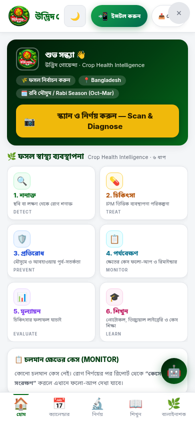
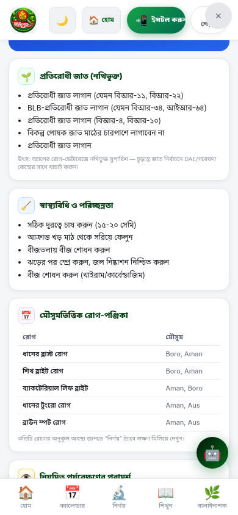

# উদ্ভিদ গোয়েন্দা | CABI Crop Health Intelligence

> **DETECT → TREAT → PREVENT → MONITOR → EVALUATE → LEARN**
>
> One crop. One connected case. One continuous intelligence cycle.


---

## Overview

**উদ্ভিদ গোয়েন্দা | Crop Health Intelligence** is the six-pillar evolution of the
[CABI Diagnosis](https://github.com/moniruzjaman/cabi-diagnosis) application — a unified,
mobile-first Crop Health Intelligence Platform for Bangladesh farmers and DAE extension officers.

A diagnosis report becomes a **crop-health case**; the case collects treatments, follow-up
observations and reminders; its evaluation promotes a verified personal lesson into the Learn hub —
closing the intelligence cycle. The production diagnosis engines, datasets, API security and PWA
from v4.1 are fully preserved.

### The Six Pillars

| Pillar | What it does |
|---|---|
| 🔍 **১. শনাক্ত (DETECT)** | AI vision + offline ONNX diagnosis, symptom matching, biotic/abiotic gates, differential candidates with confidence and evidence |
| 💊 **২. চিকিৎসা (TREAT)** | IPM-first management (cultural, mechanical, biological), registered Bangladesh pesticide products, FRAC/IRAC MoA groups, resistance management, treatment records |
| 🛡️ **৩. প্রতিরোধ (PREVENT)** | Documented resistant varieties, hygiene & sanitation, rotation, seasonal disease calendar, weather-based risk |
| 📋 **৪. পর্যবেক্ষণ (MONITOR)** | Crop Health Case Management: cases with crop/variety/district/GPS context, follow-up observations, severity progression, reminders |
| 📊 **৫. মূল্যায়ন (EVALUATE)** | Before/after severity comparison, outcomes, cost records, verified lessons — with an honest causality disclaimer |
| 🎓 **৬. শিখুন (LEARN)** | CABI 5-step protocol, 278-image visual field guide, 5 diagnostic games, plus your own promoted field-case lessons |

### Screenshots

| Mobile — Six-Pillar Home | Mobile — Prevention Plan |
|---|---|
|  |  |

More in [`docs/screenshots/`](docs/screenshots/) (mobile home/dark/prevent/diagnose + desktop home/diagnose).

---

## Key Features

### Six-Pillar Crop Health Workflow
- **Six-Pillar Home Dashboard** — branded welcome header with crop/location/season context, prominent Scan & Diagnose action, pillar navigation grid with live case badges, follow-up reminders, active cases, seasonal risk alerts, recent diagnoses, recommended learning
- **Crop Health Case Management** — create/update cases (crop, variety, district, growth stage, GPS with permission), severity progression chart, unified timeline, follow-up observations with optional photos, treatment records (type, product, MoA group, cost), monitoring reminders, status lifecycle
- **Evidence-Preserving Diagnosis** — every saved case records the diagnosis source (AI/offline/manual), provider, confidence and alternatives, so "why was this suggested" stays answerable months later
- **Intervention Evaluation** — before/after severity comparison, outcome records, cost tracking, user-verified lessons; image comparison alone is never claimed as treatment-effectiveness proof
- **Field-Case Learning** — promoted case lessons appear in the Learn hub, always labelled personal field experience (never as CABI guidance)

### Learning-Focused Design
- **CABI 5-Step Guide** — Step-by-step read-aloud guide covering the full diagnostic protocol (Observation → Exclusion → Disease Triangle → Confirmation → IPM Decision)
- **5 Interactive Games** — SymptomSpotter, CauseDetective, DiseaseTriangle, FieldScout, IPM Commander — practice each diagnostic step through play
- **Read-Aloud TTS** — Bengali text-to-speech accessibility for illiterate farmers (volume icon on every section)

### Smart Diagnosis (preserved from v4.1)
- **AI-Powered Identification** — Multi-provider AI waterfall (Gemini 2.5 Flash → OpenRouter Qwen-VL → Groq Llama4 Scout → Gemini text → Emergency fallback) for crop problem diagnosis
- **Crop-Doctor Diagnostic Engine (v4.1)** — Offline rule-based engine with language normalization + canonical synonym resolution, IDF-weighted cross-language symptom matching (EN/BN parity), normalized abiotic/biotic exclusion gates, token-set Jaccard vision fusion, and additive evidence-based confidence scoring
- **On-Device Vision Models** — MobileNetV3 (PlantVillage) + ViT ensemble running fully in-browser via ONNX Runtime Web; models sourced from [`moniruzjaman/kaggle-dataset`](https://github.com/moniruzjaman/kaggle-dataset) with provenance recorded in `public/models/manifest.json`
- **Image Analysis** — Upload up to 4 photos for AI visual diagnosis; crop auto-detection from the first image
- **278 Symptom Images** — Visual reference gallery for pest, disease, and deficiency identification (all stored locally)
- **Bangladesh Context** — DAE, BRRI, BARI recommendations; local pesticide brands and dosage
- **Weather-Aware** — Real-time temperature, humidity, rainfall with pest-risk assessment and spray-timing guidance
- **AI Copilot** — Floating assistant button available on every page for contextual help

### Modern Mobile-First UI
- **Bottom Navigation** — 5-tab bar (Home → Calendar → Diagnose → Learn → Pesticide); the six pillars live inside the Home dashboard and workflows, not as extra tabs
- **Dark Mode** — Full dark theme support with CSS custom properties and design tokens
- **PWA Installable** — Works offline as a native-like app on Android/iOS

### Pesticide Database (বালাইনাশক tab)
- **AgriChem Guide & Pest Control Database** embedded as its own tab: DAE/PTAC-registered products, MoA rotation planner, dosage calculator, PPE checklists and regulatory alerts.
- **Always up to date with upstream** — the data is synced from the source of truth repo [`moniruzjaman/AgriChem-Guide-Pest-Control-Database`](https://github.com/moniruzjaman/AgriChem-Guide-Pest-Control-Database):
  - `npm run sync:agrichem` clones/fetches upstream into `.agrichem-upstream/` (a plain clone, not a submodule), copies the datasets/types/utils into `src/agrichem/`, regenerates the curated enrichment file, and records the upstream commit SHA in `src/agrichem/data/upstreamMeta.js`.
  - `npm run check:agrichem` exits non-zero if the embedded database is stale (used by CI).
  - The tab footer shows a "DB synced" badge with the sync date + upstream commit so provenance is always visible.

### Privacy Commitments
- Crop photos are **never uploaded** to any server.
- Case thumbnails are stored on-device only, and only with explicit per-case consent.
- Unverified user feedback is never auto-promoted into authoritative agricultural knowledge.

---

## Security & Architecture

This app follows a **zero-trust security model** — no secrets ever reach the frontend.

| Layer | Implementation |
|-------|---------------|
| **API Key Isolation** | All AI provider keys (Gemini, Groq, OpenRouter) are server-side only. Frontend has zero `VITE_` env vars with secrets. |
| **HMAC Request Signing** | Every API request is signed with an auto-derived HMAC-SHA256 signature. No manual `API_SIGNING_SECRET` needed — derived from Turso credentials. |
| **Admin Auth** | Admin access to `/api/test` is auto-derived from Turso credentials. No manual `ADMIN_SECRET` env var. |
| **CORS Hardening** | Explicit origin allowlist + auto-allow `*.vercel.app` deployments. `X-Request-Signature` in allowed headers. |
| **Rate Limiting** | Built-in per-IP rate limiting on diagnosis endpoint to prevent abuse. |
| **Input Validation** | Message structure validation, image size/count limits, HTML escaping on all user inputs. |
| **Security Headers** | `vercel.json` enforces X-Content-Type-Options, X-Frame-Options, Referrer-Policy, and Content-Security-Policy. |

Crop-health cases are **local-first** (device storage) by design — no database migration is
required. See [`docs/six-pillar-architecture.md`](docs/six-pillar-architecture.md) for the data
model and the documented future server-sync path.

---

## Bangladesh Coverage

| Feature | Details |
|---------|---------|
| **Crops** | 100+ varieties across 10 categories (Rice, Jute, Potato, Tomato, Brinjal, Mustard, Banana, Mango, Wheat, Maize) |
| **Diseases** | 200+ crop diseases with symptom descriptions and treatment recommendations |
| **Districts** | 25+ Bangladesh districts with local context |
| **Seasons** | Boro, Aman, Aus, Rabi, Kharif-1, Kharif-2 |
| **Pesticides** | 5,453 registered products (AgriChem DB) with local brand names |
| **Symptom Images** | 278 locally-hosted diagnostic reference images |

---

## Tech Stack

| Layer | Technology |
|-------|-----------|
| **Frontend** | React 18 + Vite 5 (single-file architecture with lazy-loaded games) |
| **AI Providers** | Google Gemini 2.5 Flash → OpenRouter → Groq (multi-provider fallback waterfall) |
| **Database** | Turso SQLite (libSQL) — 9GB free, 1B reads/month, no pausing |
| **Security** | HMAC-SHA256 request signing, auto-derived secrets |
| **Styling** | Inline CSS-in-JS with design tokens + CSS custom properties (dark mode support) |
| **Fonts** | Noto Sans Bengali, Plus Jakarta Sans, Inter (Google Fonts) |
| **TTS** | Web Speech API (bn-BD) with custom rate/pitch tuning |
| **PWA** | Service Worker (network-first for API) + Web App Manifest |
| **Deployment** | Vercel with serverless API proxy |
| **Lint** | ESLint 10 + React Hooks plugin — 0 errors |
| **Formatting** | Prettier — consistent code style |

---

## Project Structure

```
cro-health-intelligence/
├── src/
│   ├── App.jsx                         # Main app: navigation, diagnosis flow, six-pillar dashboard
│   ├── main.jsx                        # React entry point with Error Boundary
│   ├── components/
│   │   ├── dashboard/
│   │   │   ├── SixPillarGrid.jsx       # Six-pillar navigation grid (Home)
│   │   │   └── sixPillars.js           # Shared pillar config (single source of truth)
│   │   ├── cases/
│   │   │   ├── CaseManager.jsx         # Crop Health Case Management (MONITOR + EVALUATE)
│   │   │   └── PreventionPlan.jsx      # Prevention plan view (PREVENT)
│   │   ├── CropCalendarDashboard.jsx   # Calendar + weather + price comparison
│   │   ├── UnifiedLearnResourceHub.jsx # Learn hub (protocol, science, games, field-case lessons)
│   │   ├── VisualDiagnosisLibrary.jsx  # 278-image CABI field guide
│   │   ├── OnboardingFlow.jsx          # First-use onboarding wizard
│   │   └── OutbreakList.jsx            # Disease outbreak heatmap & list
│   ├── data/
│   │   ├── cropHealthCases.js          # Local-first crop-health case store
│   │   ├── cropCalendar.js             # 12-month crop season data
│   │   ├── cropDiseases.js             # 200+ disease database
│   │   ├── pesticideRegistry.js        # Registered-product lookup (AgriChem-synced)
│   │   ├── moaDatabase.js              # FRAC/IRAC MoA groups + rotation guidance
│   │   ├── agronomicEngine.js          # Season/weather ensemble scoring
│   │   ├── weatherService.js           # Weather API + disease pressure scoring
│   │   └── themes.js                   # Dark/light theme tokens
│   ├── offline/                        # Offline ONNX diagnosis (ViT, PlantVillage, ensemble)
│   ├── games/                          # 5 CABI diagnostic games
│   └── agrichem/                       # Embedded AgriChem pesticide app
├── public/                             # PWA assets, models, 278 images, privacy policy
├── api/                                # Vercel serverless functions (HMAC-signed)
├── docs/                               # Audit, architecture, release notes, screenshots
├── setup-vercel-env.sh                 # One-command Vercel env var setup
├── vercel.json                         # Deployment config + security headers
└── .env.example                        # Environment variable reference
```

---

## Getting Started

**Prerequisites:** Node.js 18+

```bash
# Clone the repo
git clone https://github.com/moniruzjaman/cro-health-intelligence.git
cd cro-health-intelligence

# Install dependencies
npm install

# Run dev server
npm run dev          # http://localhost:5173

# QA gates
npm run lint         # ESLint
npm run format:check # Prettier
npm run build        # Production build
npm run test:offline # Offline ensemble test suite
```

### Vision orchestration and privacy

The cloud diagnosis path is free-tier-first and sequential, with conservative request/image caps, provider fallbacks, bounded timeouts, and redacted telemetry. Uploaded crop images are transient inference input only; diagnosis results and minimized metadata are stored, never the images themselves. See [`docs/vision-orchestration.md`](docs/vision-orchestration.md) for provider integration, limits, privacy boundaries, and troubleshooting.

---

## Environment Variables

All sensitive operations are server-side. The frontend has **zero secret env vars**. Only 5 variables are required:

| Variable | Required | Purpose |
|----------|----------|---------|
| `GEMINI_API_KEY` | Yes* | Google Gemini AI provider |
| `GROQ_API_KEY` | Yes* | Groq AI provider |
| `OPENROUTER_API_KEY` | Yes* | OpenRouter AI provider |
| `TURSO_DATABASE_URL` | Recommended | Turso SQLite database URL (enables analytics) |
| `TURSO_AUTH_TOKEN` | Recommended | Turso auth token |

\* At least one AI provider key is required for diagnosis to work.

**Quick setup:** Run `bash setup-vercel-env.sh` to configure all Vercel env vars interactively.

### Turso Database Setup (Free)

```bash
curl -sSfL https://get.tur.so/install.sh | bash
turso db create cro-health-intelligence
turso db show cro-health-intelligence --url
turso db tokens create cro-health-intelligence
```

Tables are auto-created on first API call — no manual migrations needed.

---

## Install as App

The app is PWA-enabled. On Android Chrome:
1. Open the app URL
2. Tap "Add to Home Screen" from the browser menu
3. The app installs as a native-like experience

---

## Deploy to Vercel

```bash
npm i -g vercel
vercel          # preview deployment
vercel --prod   # production
```

Or connect the GitHub repo at [vercel.com](https://vercel.com) for auto-deploys on push. See
[`docs/six-pillar-release-notes.md`](docs/six-pillar-release-notes.md) for full deployment steps
and rollback notes.

---

## Tab Navigation

| Tab | Bangla | Icon | Purpose |
|-----|--------|------|---------|
| Home | হোম | Home | Six-pillar dashboard: welcome context, Scan & Diagnose, pillar grid, cases, reminders, risk, learning picks |
| Crop Calendar | ক্যালেন্ডার | Calendar | 12-month planting/harvesting calendar with weather + price comparison + outbreak alerts |
| Diagnose | নির্ণয় | Microscope | AI + offline diagnosis with image analysis; report feeds the case workflow |
| Learn | শিখুন | Book | CABI 5-step protocol, visual library, games, field-case lessons |
| Pesticide | বালাইনাশক | Leaf | AgriChem registered-product database, MoA rotation, dosage calculator |

---

## Changelog

### v5.0.0 — Six-Pillar Crop Health Intelligence Transformation
- **Six-Pillar Home Dashboard** — branded welcome header (crop/location/season context), prominent Scan & Diagnose action, six-pillar navigation grid with live case badges, follow-up reminders widget, active cases widget, seasonal risk alerts, recent diagnoses, recommended learning
- **Crop Health Case Management (MONITOR)** — local-first case store mirroring the logical entity model (crop_health_cases, case_observations, diagnosis_evidence, treatment_records, prevention_actions, monitoring_records, evaluation_results, learning_insights) with stable IDs, timestamps and verification fields; cases carry crop/variety/district/GPS context, severity progression chart, unified timeline, follow-up observations, treatment records and monitoring reminders
- **Intervention Evaluation (EVALUATE)** — before/after severity comparison, outcome/cost/lesson records, user-verification flag, explicit causality disclaimer (image comparison alone never claimed as treatment-effectiveness proof)
- **Prevention Plan (PREVENT)** — documented resistant varieties, hygiene, rotation and seasonal disease calendar derived from the agronomic datasets via `resolveCropKey`; nothing invented
- **Diagnosis → Case bridge (DETECT/TREAT)** — the report gains "কেসে সংরক্ষণ" (Save to Case, with full evidence: source, provider, confidence, alternatives) and "প্রতিরোধ দেখুন" actions
- **Field-Case Learning (LEARN)** — "মাঠ-কেস শিক্ষা" sub-view in the Learn hub showing the farmer's own promoted case lessons, labelled personal field experience
- **Privacy by design** — case photos only persisted as on-device thumbnails with explicit per-case consent (default off), never uploaded
- Baseline v4.1 functionality fully preserved: diagnosis waterfall, offline ONNX engine, AgriChem DB, PWA, API security, 5-tab navigation

### v4.1.0 — Doctoral-Advice Diagnosis Upgrade (crop-doctor port) & On-Device Model Verification
- **Language normalization layer** (`src/data/bengaliKeywords.js`) — canonical synonym resolution via the `SYMPTOM_SYNONYMS` doctoral-advice dictionary; Bengali input translates with multi-match symmetry so EN and BN queries produce identical rankings
- **IDF-weighted cross-language matcher** (`src/data/cropDiseases.js`) — coverage-aware symptom matching with inverse-document-frequency weighting and deterministic tie-breaking
- **Normalized exclusion gates** (`src/offline/diagnosticEngine.js`) — biotic-weighted abiotic/biotic assessment; all four exclusion gates use the shared `hasSign()` normalized helper
- **Evidence-based confidence** — additive `evidenceScore` (0–100) replacing the suspect-count heuristic
- **Hardened vision fusion** — token-set Jaccard disease matching; vision-only evidence capped at "medium"
- **MobileNet / PlantVillage / Kaggle models verified functional** — all ONNX assets present under `public/models/`, manifest v2.0.0 points to the source-of-truth repo
- **Regression suite green** — `npm run test:offline` passes, including EN/BN parity and tie-break assertions

### v4.0.0 — Production Hardening & Turso Migration
- Replaced Supabase with Turso SQLite; zero-trust API security with HMAC-SHA256 request signing; auto-derived secrets; hardened CORS; rate limiting; input validation; persistent analytics

### v3.0 — AI Rewrite
- Multi-provider AI waterfall; Vercel serverless API proxy; real-time weather + GPS/IP location; voice input + TTS

### v2.0 — UI Overhaul
- Tabbed navigation; Bangladesh pesticide dataset; 5 CABI protocol games; PWA install + social sharing

### v1.0 — Initial Release
- Basic Gemini-powered diagnosis; CABI 5-step guide; symptom image gallery

---

## Credits

**Supported by:** CABI Plantwise · DAE Bangladesh · BRRI · BARI
**Built with:** React · Vite · Turso SQLite · Gemini AI · Google Fonts
**Upstream:** [cabi-diagnosis](https://github.com/moniruzjaman/cabi-diagnosis) · [AgriChem Guide & Pest Control Database](https://github.com/moniruzjaman/AgriChem-Guide-Pest-Control-Database)
**YouTube:** [@AgriWisdomBd](https://youtube.com/@AgriWisdomBd)

---

## License

MIT License — see [LICENSE](LICENSE) for details.
